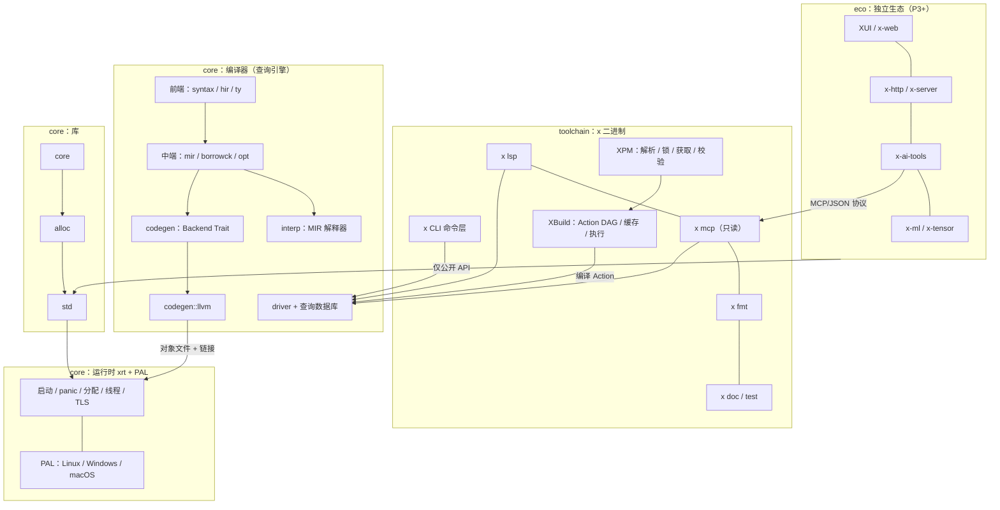
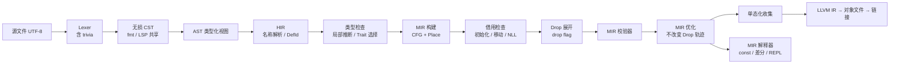
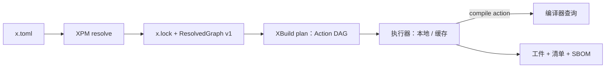
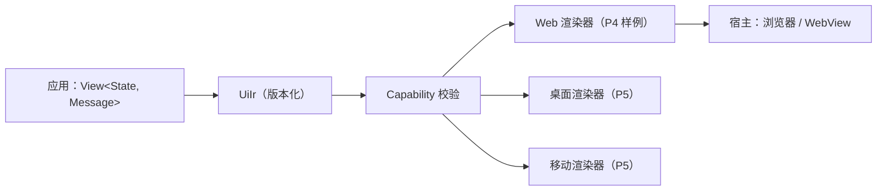

# 总体技术架构

> 状态：Accepted｜版本：2.1.0｜负责人：Compiler Lead｜最后更新：2026-10-22
> 类型：Architecture｜唯一负责：系统分层、组件边界、数据契约。编译器内部细节见 [compiler](design/compiler.md)，目录与 crate 见 [repository](repository.md)。

## 1. 结论（7 条架构决策）

1. **单一 `x` 二进制**：编译器、XPM/XBuild、fmt、test、doc、LSP、MCP 都是它的子命令，共享同一个查询引擎（[ADR-0002](decisions/ADR-0002-repository-modular-monolith.md)）。
2. **管线**：`Source → Lexer → 无损 CST → AST → HIR(名称解析) → 类型检查 → MIR → 借用检查 → Drop 展开 → MIR 优化 → Codegen(LLVM)`（[ADR-0005](decisions/ADR-0005-query-compiler-and-lossless-cst.md)）。
3. **查询式增量**：P1 起所有阶段都是带缓存的纯查询；P3 起支持落盘缓存。
4. **MIR 解释器是语义 Oracle**：它同时用于 const 求值、差分测试和 REPL（[ADR-0006](decisions/ADR-0006-mir-interpreter-oracle.md)）。
5. **LLVM 只出现在 `codegen::llvm`**，前端不依赖 LLVM（[ADR-0001](decisions/ADR-0001-host-and-backend.md)）。
6. **运行时最小化**：xrt 只负责启动、panic、分配、线程、PAL。1.0 没有调度器，也没有 GC。
7. **生态隔离**：XUI、AI 工具、ML、服务端框架只依赖公开 API，并且通过版本化数据契约（UiIr、诊断 JSON、查询协议）交互。

## 2. 系统分层

依赖方向（必须满足，由 `cargo xtask check-deps` 检查）：
- `toolchain → core.compiler → core.runtime`；
- 库链为 `core → alloc → std → xrt`；
- `eco` 只能依赖 `std` 和公开协议。
- **禁止**任何反向依赖，以及 `eco/labs` 进入核心依赖图。

## 3. 编译器管线

| 阶段 | 输入 → 输出 | 失败诊断段 | 首次阶段 |
|---|---|---|---|
| Lexer | 字节 → Token（含 trivia） | X-E10xx | P0 |
| Parser | Token → 无损 CST（带错误恢复） | X-E10xx | P0 |
| AST | CST → 类型化视图（零拷贝包装） | — | P0 |
| HIR lowering + 名称解析 | AST → HIR + DefMap | X-E20xx | P0（单文件）/ P1（多文件） |
| 类型检查 | HIR → TypedHIR（类型表 + Trait 选择结果） | X-E30xx | P0 子集 / P1 |
| MIR 构建 | TypedHIR → MIR | — | P0 |
| 借用检查 | MIR → 借用结果 | X-E40xx | P0（仅移动）/ P1（受限）/ P2（完整） |
| Drop 展开 | MIR → MIR（显式 drop） | — | P1 |
| 优化 | MIR → MIR | — | P1 |
| 代码生成 | MIR + TargetSpec → 对象文件 | X-E0004/0005 | P0 |

## 4. 运行时与标准库

| 组件 | 实现语言 | 职责 | 不负责 |
|---|---|---|---|
| `xrt`（runtime crate，`staticlib`） | Rust（`no_std` + 平台 API） | 进程入口 `xrt_start → main`、panic 处理（打印 + abort）、分配器钩子（默认系统 malloc）、线程创建、TLS、栈溢出保护、退出码 | 调度器、GC、I/O 策略 |
| PAL | Rust（xrt 内部模块） | 文件、进程、时间、环境、线程原语的系统调用封装 | 网络协议 |
| `core` | X | 原语方法、`Option/Result`、Trait、Iterator、`str`/切片、`range` | 分配 |
| `alloc` | X | `Box/Vec/String/Rc/Arc` | OS 访问 |
| `std` | X | `io/fs/env/process/thread/sync/time/path/collections` | 生态协议 |

X 库通过**内建函数（intrinsic）**调用 xrt。intrinsic 清单由 [compiler](design/compiler.md) §7 唯一维护。

## 5. 工具链与包管理

- **XPM** 只决定“用哪些包”，**XBuild** 只决定“怎么构建”。编译器不回调 Resolver（[ADR-0004](decisions/ADR-0004-xpm-xbuild-layering.md)）。
- 分期：P1 Path 依赖；P2 Git + PubGrub；P3 Registry + 签名 + 远程只读缓存；P4 publish/yank。
- 契约（ResolvedGraph、Action DAG、诊断 JSON、工件清单）都带 `schema_version`。读取方遇到未知主版本时必须拒绝。

## 6. LSP / MCP / AI 协作层

| 组件 | 阶段 | 职责 | 边界 |
|---|---|---|---|
| `x lsp` | P3 | LSP 协议适配：诊断、补全、跳转、重命名、格式化、语义高亮 | 只调用 driver 查询，不复制语义 |
| `x mcp` | P3 | MCP 只读工具：`diagnostics`、`type_of`、`definition`、`references`、`explain`、`deps_tree` | 默认只读；写操作只能以补丁提案形式返回 |
| `x query --json` | P1 | 命令行查询（CI、脚本、Agent 共用） | 输出 JSON schema 版本化 |
| `x-ai-tools`（eco） | P3/P5 | 上下文打包、策略、评测、溯源 | 不进入编译关键路径；遵守 [GOVERNANCE](../GOVERNANCE.md) §6 |

“AI 原生”的含义是：稳定诊断码、确定的名称解析、规范格式化、机器可读查询。AI 生成的内容**不得**影响编译语义。

## 7. UI / 平台层（eco）

- XUI 是普通库，不新增关键字。
- 平台能力通过 `Capability<Target>` 显式声明；不支持的能力在编译期或启动时报错，禁止静默降级。
- 详见 [ecosystem](ecosystem.md) §2。

## 8. 跨层数据契约

| 契约 | 生产者 → 消费者 | 版本 | 首次阶段 |
|---|---|---|---|
| 诊断 JSON | 编译器 → CLI/LSP/MCP/CI | `diag-v1` | P0 |
| ResolvedGraph | XPM → XBuild | `graph-v1` | P1 |
| Action DAG | XBuild → 执行器 | `plan-v1` | P1 |
| 工件清单 | XBuild → 发布 | `artifact-v1` | P1 |
| 查询协议 | driver → LSP/MCP/`x query` | `query-v1` | P1 |
| MIR dump | 编译器 → 测试 | `mir-v1`（仅测试用，不对外稳定） | P0 |
| UiIr | XUI → 渲染器 | `uiir-v1` | P3（eco） |
