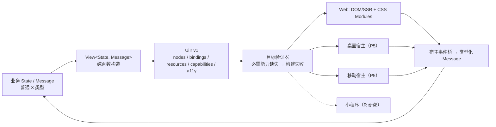

# 生态与研究赛道

> 状态：Proposed｜版本：2.1.0｜负责人：Ecosystem Lead｜最后更新：2026-10-22
> 类型：Ecosystem｜唯一负责：eco/labs 包的边界、清单、准入与晋级规则，以及 XUI 和 x-json 的契约。各条目的阶段以[登记册](requirements/registry.md)为准。取代旧 RFC-0010、RFC-0011 与旧 xui-and-platforms 设计。

## 1. 结论

1. 生态包是**普通 X 包**：只依赖 std 公开 API 与稳定工具协议；不得要求核心新增关键字，也不得读取编译器私有 IR。
2. 官方包（`x-` 前缀）从 P3 起分批发布，每个都有 Owner、语义化版本和独立 CI。
3. Labs（研究赛道 R）默认关闭，有独立预算，不阻塞主线；晋级必须经过 RFC。
4. 原始需求中不可行、或不应进入核心的能力，全部在这里有替代落点，见 [vision](vision.md) §6。

## 2. XUI（取代 RFC-0011）

### 2.1 目标与非目标

包名为 `x-ui`（独立仓库，见 [repository](repository.md) §6）。

- 目标：用普通 X 类型与函数编写声明式 UI。跨宿主时，状态、事件、导航、资源与无障碍的语义一致。
- 非目标：像素一致；所有宿主 API 等价；为 UI 新增关键字或第二套类型系统；自研统一布局或自绘引擎（P5 前）。

### 2.2 分层



### 2.3 契约（候选名称；P3 原型通过前不稳定）

```x
pub trait App {
    type State;
    type Message;
    fn init() -> Self::State;
    fn update(state: &mut Self::State, msg: Self::Message);
    fn view(state: &Self::State) -> View<Self::Message>;
}
```

1. 渲染器不拥有业务状态，状态只能通过 `update` 修改。
2. P3 的事件模型是同步消息队列；异步宿主任务通过显式 `Command` 返回（依赖 P5 async 时再修订）。
3. `Capability`：应用声明必需能力与可选能力。必需能力缺失时构建失败；可选能力必须提供替代路径，否则报错，不得静默降级。
4. UiIr 带 `version`，向后兼容规则在 P4 Web 发布前锁定。

### 2.4 晋级表

| 阶段 | 宿主 | 门禁 | 失败时 |
|---|---|---|---|
| P3 | Web 原型（静态页、表单、列表、导航） | 示例可运行；UiIr 夹具可复现；资源失败路径有测试 | 保持实验状态 |
| P4 | Web 产品样例 | 跨浏览器；键盘与屏幕阅读器；SSR/水合；包体与延迟基线 | 不声称支持稳定 Web |
| P5 | 桌面（Windows/Linux 先，macOS 后） | 各 OS 分别验收安装、无障碍、权限、生命周期 | 只阻断该 OS |
| P5 | 移动（Android/iOS） | 真机、后台/恢复、权限、包体、电量、上架 | 只阻断该设备/OS |
| R | 小程序（先微信） | 研究产出：模板/样式/逻辑转译的可行性报告 + 官方工具出包 + 真机验证 | 不声称支持 |

## 3. 官方包清单（按阶段）

| 阶段 | 包 | 范围 | 对应需求（示例） |
|---|---|---|---|
| P3 | `x-json` | 见 §4 | XLF-09-002、XLF-12-010 |
| P3 | `x-http` | HTTP/1.1 + TLS（绑定成熟 TLS 库），阻塞式 | XLF-04-008 |
| P3 | `x-log` / `x-metrics` | 结构化日志 + OTLP 导出；Counter/Gauge/Histogram | XLF-09-004、XLF-09-005 |
| P3 | `x-cli-args` | 参数与配置分层（Trait + 代码生成工具，无宏） | XLF-09-007 |
| P3 | `x-regex`、`x-decimal`、`x-time`（HLC）、`x-ipc`、`x-mmap`、`x-bitfield` | 运行时正则；十进制；混合逻辑时钟；IPC/共享内存；显式 madvise；位域 | XLF-10-005、10-004、07-005、05-004、05-010、10-006 |
| P3 | `x-bindgen` | 从 X 导出生成 C 头文件；Python/Node 绑定放到 P5 | XLF-10-015、07-015 |
| P3/P5 | `x-ai-tools` | 见 §5 | XLF-03-005 等 |
| P4 | `x-http` 2 / gRPC、`x-server`、`x-auth`、`x-crypto`、`x-db`（同步连接池/迁移）、`x-sched`（Timer/Cron/Leader）、`x-bus`、`x-resilience`、`x-deadline` | 服务端基础 | XLF-06-007、09-014、07-007、09-012、09-013、12-005、07-012、12-016 |
| P5 | `x-tensor`、`x-ml`、`x-arrow`、HTTP/3/QUIC、async 版本的生态包 | 见 §6 | XLF-04-001…013、12-008 |

准入门禁（每个官方包）：
- 有 README 与 API 文档；
- 公开 API 的测试覆盖率 ≥ 80%（行覆盖）；
- 处理不可信输入的包必须接入 fuzz，并有资源上限；
- Tier 1 CI 通过；
- 使用 SemVer，并接入 `x api-diff`（P4 起）。

## 4. x-json（取代 RFC-0010）

1. JSON 是官方库，不是核心语法；1.0 没有 JSON 字面量。
2. 数据模型：

```x
pub enum JsonValue {
    Null,
    Bool(bool),
    Number(JsonNumber),
    String(String),
    Array(Vec<JsonValue>),
    Object(JsonObject),       // 保留输入顺序；顺序不参与相等比较与规范化
}
```

3. `JsonNumber` 保存精确的十进制文本。拒绝 NaN、Infinity 与前导零。`to_i64/to_u64/to_f64` 都返回 `Result`，不做静默截断。
4. API：

```x
pub fn decode<T: FromJson>(input: &str, limits: &DecodeLimits) -> Result<T, JsonError>;
pub fn decode_value(input: &str, limits: &DecodeLimits) -> Result<JsonValue, JsonError>;
pub fn stream<R: Read>(reader: R, limits: &DecodeLimits) -> JsonStream<R>;
pub fn encode<T: ToJson>(value: &T) -> Result<String, JsonError>;
pub fn encode_canonical<T: ToJson>(value: &T) -> Result<Vec<u8>, JsonError>;
```

   借用式解码（结果引用输入）需要显式生命周期，1.0 不提供，见 [04](../specs/language/04-ownership-borrowing.md) §4。
5. 重复键默认 `RejectDuplicate`，可以显式选择 `KeepFirst/KeepLast`；规范化输出强制拒绝重复键。键比较基于解码后的 Unicode 标量序列，不做 Unicode Normalization。
6. `DecodeLimits` 必须包含以下上限，默认值都有限：输入字节、嵌套深度、字符串字节、数字字符数、数组项数、对象成员数、总分配字节。超限时返回 `JsonError::LimitExceeded`，不得 panic。
7. `encode_canonical` 遵循 RFC 8785（JSON Canonicalization Scheme，2020 年 6 月发布）。实现时以 RFC Editor 发布的勘误为准，并锁定一套兼容语料。无法无损规范化的数字返回 `NonCanonicalNumber`。
8. `FromJson/ToJson` 在 1.0 中手写实现，或由 `x-json-gen` 工具从类型定义生成代码（构建前生成，产物提交入库）。
9. 验收：重复键、深度炸弹、巨大数字、非法 UTF-8 与转义、截断输入的语料；流式解析的分块边界穷举；规范化输出跨平台逐字节一致；与另一实现做差分 fuzz。

## 5. AI 协作工具（x-ai-tools、MCP）

| 阶段 | 能力 | 约束 |
|---|---|---|
| P3 | `x mcp`：只读工具（诊断、符号、文档、测试列表） | 不执行写操作；所有调用写入审计日志 |
| P3 | `x explain X-Exxxx`、`x fix --suggest` | 只输出建议补丁，不自动应用 |
| P5 | 受控写操作：计划 → dry-run → 人工审批 → 执行 → 测试 | 权限白名单；不读取秘密；遵守 [GOVERNANCE](../GOVERNANCE.md) §6 |
| P5 | 本地检索与项目记忆（opt-in）、模板市场（签名模板） | 默认关闭；数据保留在本地 |

AI 工具不进入编译关键路径。构建结果不得依赖模型输出。

## 6. ML / 数据 / 硬件（全部由生态承接）

| 原始需求 | 替代落点 | 原因 |
|---|---|---|
| 内建 Tensor 与 Shape 推导 | `x-tensor` 库：运行时检查 Shape；静态维度等 const 泛型（1.0 后）再评估 | 内建会把特定领域固化进核心类型系统 |
| 编译期自动微分 | 库级 Tape Autograd；编译期 AD 作为研究项 | 需要宏/编译器插件，1.0 不提供 |
| CUDA/ROCm/Metal Kernel 生成 | 通过 FFI 调用成熟的内核库 | 自研 GPU 后端的成本超出项目范围 |
| 静态图优化与自动并行 | 导出 ONNX，交给成熟的图编译器（R） | 同上 |
| LoRA/量化/分布式训练/训练即服务 | 通过 Python 互操作或外部服务编排（`x-ai-tools`） | 复用成熟框架 |
| 模型导入 | `x-ml`：safetensors/GGUF/ONNX 读取 | 纯解析，可行 |
| CPU/GPU 统一内存 | 显式 `ManagedBuffer` + 同步/迁移 API | 隐式统一内存不可移植 |
| 用户态网络栈 | `std::os::linux` 平台扩展 + 生态包绑定 DPDK/io_uring（P5） | 核心不承担协议栈 |

## 7. Labs（研究赛道 R）规则

1. 每个研究项都需要提交 1 页研究提案：问题、假设、成功判据、预算、退出条件。
2. 研究代码放在独立仓库 `x-labs-*`，只依赖公开 API，任何 Stable 工件都不得依赖它。
3. 晋级路径：研究报告 → RFC（Draft）→ 进入 eco 或 core 的阶段计划。
4. 当前研究项：可选 GC、Effect 系统、ZKP 电路互操作、有界模型检查 `x verify`（承接 `@intend`）、小程序转译、影子环境回放、编译期 AD、硬实时认证、脑机接口适配。
