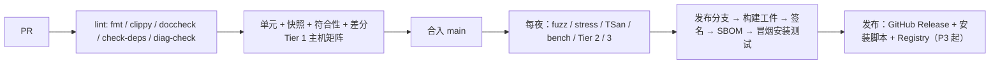

# CI/CD 与发布

> 状态：Accepted｜版本：2.1.0｜负责人：Release Lead｜最后更新：2026-10-22
> 类型：Release｜唯一负责：CI 流水线、版本与 Edition、渠道、工件、签名、CHANGELOG、回滚。

## 1. 结论

1. 工具链使用 SemVer：1.0 之前是 `0.MINOR.PATCH`，MINOR 可以有破坏性变更；1.0 之后只有 Edition 能引入破坏性的语言变化。
2. 渠道：`nightly`（每夜）、`preview`（P2 起，每 6 周一次）、`stable`（1.0 起，每 6 周一次，采用与 Rust 相同的列车模型）。1.0 起每年指定一个 LTS（[ADR-0008](decisions/ADR-0008-pre-kickoff-decisions.md) K10）。
3. 从 P2 的 preview 起，每个发布工件都附带 SHA-256、cosign 无密钥签名、CycloneDX SBOM 和 GitHub Artifact Attestation（SLSA Provenance），见 §5。

## 2. 版本与 Edition

| 项目 | 规则 |
|---|---|
| 工具链版本 | `x --version` 输出 `x 0.4.1 (commit 1a2b3c4 2026-10-22)` 这样的格式 |
| Edition | 由包在 `x.toml` 中声明 `edition = "preview"`。1.0 前只有 `"preview"`；首个稳定 Edition 以 1.0 发布的年份命名（例如 `"2028"`）；之后两个 Edition 至少间隔 3 年 |
| Edition 兼容 | 同一编译器必须同时支持所有稳定 Edition；不同 Edition 的包可以互相依赖；Edition 之间只能改语法与 lint 默认值，不能改 ABI 或类型系统的核心语义 |
| 迁移 | 每个 Edition 都要提供 `x fix --edition` 自动迁移工具，并保证迁移后的代码在新旧 Edition 下都能编译（可能有 lint 警告） |
| 诊断码 | 诊断码一经发布就永不复用；废弃的码保留在登记册中，标记为 `Deprecated` |
| 包格式 | `x.lock` 带 `version`；新版本工具链必须能读取旧版本的 lockfile |

## 3. 渠道

| 渠道 | 阶段 | 来源 | 保证 |
|---|---|---|---|
| nightly | M0 起 | main 分支每夜构建 | 只保证通过 CI |
| preview | P2 起 | 从 main 切出 `release/0.x` 分支，经 2 周稳定期 | 符合性 gate 全绿，基准没有超阈值的回归 |
| stable | P4 起 | 同上，经 6 周 beta 期 | 再加上 §6 发布评审 |
| LTS | 1.0 起，每年把一个 stable 版本指定为 LTS | 该 stable 版本的 `release/x.y` 分支 | 提供 12 个月安全与严重缺陷修复（只做 backport，不加功能）；相邻两个 LTS 有 3 个月重叠。1.0 之前不提供 LTS |

## 4. CI/CD 流水线

| 流水线 | 内容 | 时限 |
|---|---|---|
| PR | §4 图中的 L 与 U | ≤ 30 分钟（超出则拆分或缓存） |
| main 合入后 | 与 PR 相同，再加上 nightly 工件构建 | — |
| 每夜 | fuzz（1 CPU 小时/目标）、stress、TSan/ASan、`xbench`、Tier 2/3 | 结果写入仪表盘，失败自动建 Issue |
| 发布 | 可复现构建（两台独立构建机，比较工件哈希）、签名、SBOM、安装测试 | 人工批准后发布 |

CI 平台：**GitHub Actions**（ADR-0008 K8）。Runner 标签锁定为 `ubuntu-24.04`、`windows-2025`、`macos-15`（arm64，P1 起）、`ubuntu-24.04-arm`（P2 起，用于 aarch64 Linux Tier 2）；不使用 `*-latest`。基准机是自托管 Runner（P2 起），只运行 `bench` 工作流，不运行 PR 代码。Action 一律按 commit SHA 锁定版本，由 Dependabot 更新。工作流样例见 [p0-workplan](design/p0-workplan.md) §7.3。

## 5. 工件、签名与供应链

| 工件 | 内容 | 阶段 |
|---|---|---|
| `x-<ver>-<triple>.tar.xz` / `.zip` | `x` 可执行文件、`libxrt`、预编译 std、文档 | P1 起（nightly），P2 起（preview） |
| 安装器 | `install.sh`、`install.ps1`；1.0 提供 macOS pkg（公证）与 Windows MSI（签名） | P2 / P4 |
| `SHA256SUMS` | 所有工件的哈希 | P1 起 |
| 签名 | Sigstore `cosign sign-blob` 无密钥签名（GitHub OIDC 身份，记录进 Rekor 透明日志），用户用 `cosign verify-blob --certificate-identity …` 验证；P4 起，Windows 安装器与 `x.exe` 增加 Authenticode 签名，macOS 增加 Developer ID 签名与公证 | P2 起（P4 加平台签名） |
| SBOM | CycloneDX JSON（用 `cargo-cyclonedx` 生成，并合并 X 包依赖） | P2 起 |
| Provenance | GitHub Artifact Attestations（`actions/attest-build-provenance`），SLSA Build L2 起步，P4 达到 L3 | P2 起 |
| 可复现 | 同一提交在两台独立构建机上产出相同哈希（不含签名） | P4 门禁 |

## 6. 发布评审

### 6.1 每次 preview/stable 发布

1. Gate 全绿；没有 `Blocker` 级 Issue；
2. 基准没有超出 [performance](performance.md) §2 阈值的回归；
3. CHANGELOG 已完成，破坏性变更附迁移说明；
4. 至少 2 名 Maintainer 批准。

### 6.2 1.0 发布评审（P4 退出门禁）

| 项 | 判据 |
|---|---|
| 规范 | specs 01–08、std-core、packages 全部为 Stable；诊断登记册冻结（只能新增） |
| 目标 | [vision](vision.md) 中 G-SAFE…G-COMPAT 的指标全部达到 |
| 平台 | [platforms](platforms.md) 中的 4 个 Tier 1 全部达到门禁 |
| 性能 | [performance](performance.md) §5 中 1.0 列全部达标 |
| 安全 | 完成外部安全审查（编译器、xrt、xpm），高危问题清零；有漏洞披露流程（`SECURITY.md`） |
| 易学 | [testing](testing.md) §9 的 1.0 实验通过 |
| 供应链 | 可复现构建、签名、SBOM、Provenance 全部到位 |
| 兼容承诺 | 公布稳定性承诺文档：哪些稳定、哪些可以变 |

## 7. CHANGELOG

- 根目录 `CHANGELOG.md`，格式参考 Keep a Changelog，小节为 `Added / Changed / Deprecated / Removed / Fixed / Security / Platform`。
- 通过 PR 标签与 Conventional Commits 自动生成草稿，由人工编辑定稿。
- 破坏性变更必须带 `BREAKING:` 前缀与迁移指引的链接。

## 8. 回滚与撤回

1. 工具链发布出现 `Blocker` 级问题时：24 小时内发布 PATCH 修复；做不到就把安装脚本的默认版本回滚到上一版，并在 Release 页面标记 “withdrawn”。工件不删除，以保持可复现。
2. Registry 包使用 `x yank`（P4）：已有 lockfile 仍能解析，新解析不再选中被撤回的版本。
3. 签名密钥泄露：按 `SECURITY.md` 的流程轮换密钥，并发布受影响工件的清单。
