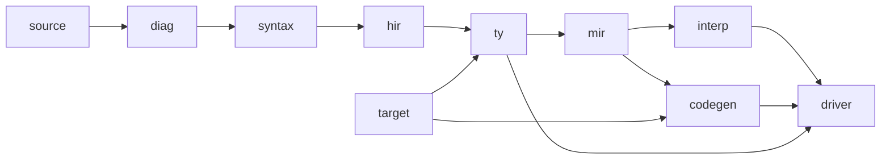

# 仓库结构、模块职责与依赖规则

> 类型：Architecture｜唯一负责：实现仓库目录、Cargo 成员、模块职责、依赖规则、拆分门禁。决策依据见 [ADR-0002](decisions/ADR-0002-repository-modular-monolith.md)。

## 1. 结论

- P0–P2 只有 **5 个 Cargo 成员**：`x-compiler`、`x-runtime`、`x-cli`、`x-conformance`、`xtask`。
- 标准库用 X 编写，位于 `library/`，不是 Cargo 成员。
- 生态包不放在本仓库。

## 2. 目录树（实现仓库 `x-lang/`）

以下是随实施阶段逐步创建的源码目录规划。当前实际文档目录见 [文档架构](README.md)，项目现有内容见 [根目录 README](../README.md) §4。

```text
x-lang/
├─ Cargo.toml  Cargo.lock     # workspace：5 个成员；Cargo.lock 入库
├─ rust-toolchain.toml        # Rust 1.99.1，与 docs/toolchain.md 一致
├─ README.md  AGENTS.md  SECURITY.md  CONTRIBUTING.md
├─ LICENSE-APACHE  LICENSE-MIT  # Apache-2.0 OR MIT（ADR-0008 K7）
├─ .editorconfig  .gitattributes  .gitignore  rustfmt.toml  clippy.toml  deny.toml
├─ .cargo/config.toml         # xtask 别名；本地 LLVM 路径写在不入库的 config.local.toml
├─ .github/                   # workflows/{ci,nightly,release}.yml、dependabot.yml、CODEOWNERS、PR/Issue 模板
├─ docs/                      # 索引、治理、工具链、架构、设计、需求和维护记录
├─ specs/                     # 语言、标准库、包格式与诊断规范
├─ rfcs/                      # 规范变更提案
├─ tools/                     # doccheck 等仓库工具
├─ archive/                   # 历史文档与原始需求
├─ compiler/                  # crate x-compiler（lib）
│  └─ src/
│     ├─ lib.rs               # 唯一门面：driver API
│     ├─ source/              # SourceId、SourceMap、Span、文件读取
│     ├─ diag/                # Diagnostic、渲染（文本/JSON）、码表（由登记册生成）
│     ├─ syntax/              # lexer、cst（无损）、parser（错误恢复）、ast（类型化视图）
│     ├─ hir/                 # lower、resolve（DefMap、可见性、导入）
│     ├─ ty/                  # types、infer、traits（选择/一致性）、check
│     ├─ mir/                 # build、borrowck、drop_elab、opt、verify、dump
│     ├─ interp/              # MIR 解释器（const 求值 / Oracle / REPL）
│     ├─ codegen/             # Backend Trait；llvm/ 子模块是唯一依赖 llvm-sys 的位置
│     ├─ target/              # TargetSpec、数据布局、ABI 分类
│     └─ driver/              # 查询数据库、Session、取消、工件清单
├─ runtime/                   # crate x-runtime（staticlib，库名 xrt）
│  └─ src/ start.rs panic.rs alloc.rs thread.rs tls.rs pal/{unix,windows}.rs（P3 增加 wasi）
├─ cli/                       # crate x-cli（bin：x）
│  └─ src/ main.rs commands/ xpm/ xbuild/ fmt/ test/ lsp/(P3) mcp/(P3) doc/(P3)
├─ conformance/               # crate x-conformance：语料发现、执行、报告、门禁
├─ xtask/                     # 开发自动化：setup-llvm、doctor、toolchain-check、llvm-probe、check-deps、diag-check、bench、dist
├─ library/
│  ├─ core/src/*.x            # P1 起
│  ├─ alloc/src/*.x           # P1 起
│  └─ std/src/*.x             # P1 起
├─ tests/
│  ├─ conformance/{p0,p1,p2,p3,p4}/{compile-pass,compile-fail,run-pass,run-fail}/  meta/
│  ├─ ui/                     # 诊断渲染快照
│  ├─ e2e/                    # CLI 端到端（含参考 CLI 程序）
│  ├─ abi/                    # C harness
│  └─ fixtures/
├─ bench/                     # xbench：{compile,runtime}/、results/、MACHINE.md
├─ fuzz/                      # cargo-fuzz 目标（独立 workspace，不计入成员）
├─ editors/vscode/            # P3 起
```

规则：
- **不得**为未到阶段的能力创建空目录或空 crate。
- `lsp/`、`mcp/`、`doc/`、`editors/` 在 P3 才创建。

## 3. 成员职责

| 成员 | 产物 | 职责 | 不负责 | 允许依赖 |
|---|---|---|---|---|
| `x-compiler` | rlib | 源码 → 诊断 / MIR / 对象文件；查询数据库 | 包解析、网络、进程编排 | `llvm-sys`（仅在 `codegen::llvm` 内）、`rowan` =0.17.0（仅在 `syntax::tree` 内）、`salsa` =0.28.5（仅在 `driver::db` 内，P1 起）；以上由 `check-deps` 强制 |
| `x-runtime` | staticlib `libxrt.a` / `xrt.lib` | 程序运行时 | 编译期逻辑 | 仅 `core`/`libc`/`windows-sys` 类平台绑定 |
| `x-cli` | 可执行文件 `x` | 命令、XPM、XBuild、fmt、test、lsp、mcp | 语义规则 | `x-compiler` 公开门面 |
| `x-conformance` | rlib + bin | 语料 runner、gate manifest、Rule ID 报告 | 编译语义 | `x-compiler` 门面 |
| `xtask` | bin | 仓库自动化 | 用户功能 | 任意开发依赖 |

## 4. 编译器内部依赖规则



1. 箭头表示“被依赖 → 依赖者”。下层**不得** `use` 上层（例如 `syntax` 不得引用 `ty`）。
2. 只有 `codegen::llvm` 可以引用 `llvm_sys`，只有 `syntax::tree` 可以引用 `rowan`，只有 `driver::db` 可以引用 `salsa`。`cargo xtask check-deps` 通过源码扫描执行这三条规则，违规即阻断 CI。
3. 跨模块只能访问 `pub(crate)` 门面函数和数据类型，不得访问其他模块的私有字段。
4. 内部工件（MIR dump、诊断 JSON、查询结果）带 `schema_version`。
5. 禁止创建 `utils`、`common`、`shared` 这类无边界模块。

## 5. 拆分门禁（模块 → 独立 crate / 仓库）

至少满足一项理由：
- 有两个以上稳定消费者；
- 有独立发布周期；
- 需要进程或权限隔离；
- 需要隔离第三方依赖；
- 有可测的编译时间收益（≥ 10%）。

并且必须同时提供：
- ADR；
- 输入/输出/错误契约；
- 无环依赖图；
- 契约测试；
- Owner；
- 回退方案。

“以后可能复用”或“目录更整齐”不算理由。成员数超过 6 个时，必须更新 ADR-0002。

## 6. 生态仓库（P3 起）

| 仓库 | 内容 | 依赖 |
|---|---|---|
| `x-json` | JSON 数据模型/编解码（[ecosystem](ecosystem.md) §4） | std |
| `x-http`、`x-server` | HTTP/gRPC/服务端 | std |
| `x-ui` | XUI、UiIr、渲染器 | std、平台绑定 |
| `x-ai-tools` | Agent 编排、上下文、评测 | `x mcp` / `x query` 协议 |
| `x-tensor`、`x-ml` | Tensor；模型格式读取与互操作 | std、FFI |
| `x-labs-*` | 研究原型 | 公开 API |

生态仓库**不得**导入编译器私有类型。这一点由各仓库 CI 中的依赖检查保证。

## 7. 用户项目模板（`x init`）

```text
my-app/
├─ x.toml
├─ x.lock          # 应用必须提交
├─ src/main.x      # 二进制入口；库为 src/lib.x
├─ tests/          # 集成测试（*.x，含 @test）
├─ .x/rules.toml   # 项目规则（lint 配置；P3）
└─ README.md
```
